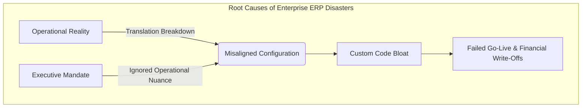
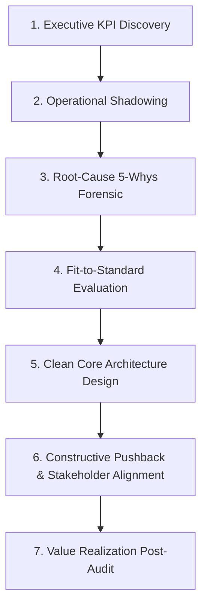
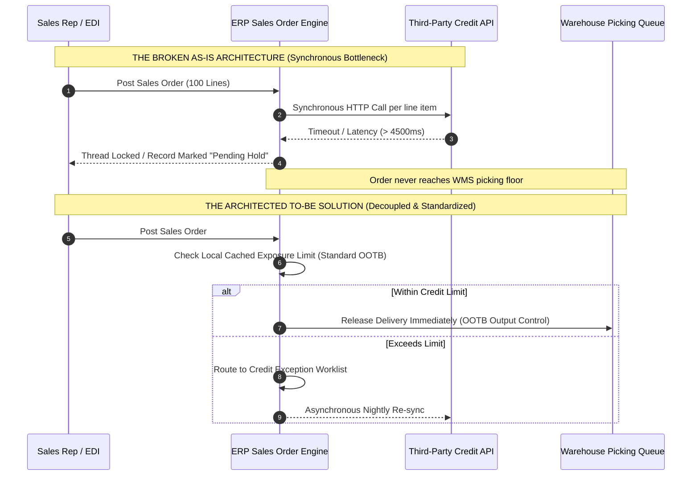
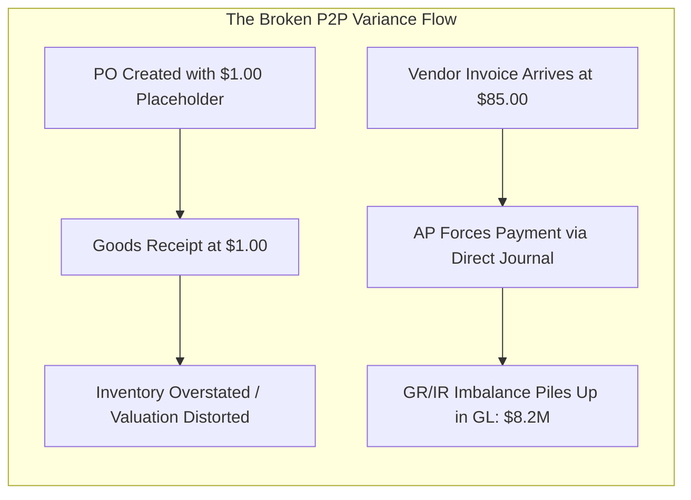

# Enterprise Business Process Translation: The Master Field Guide
## How to Transition from a $92K Technical Configurator to a $200K–$300K+ Enterprise Solution Architect

---

## Table of Contents
1. [The Economic Reality: Commoditization vs. Value Creation](#1-the-economic-reality-commoditization-vs-value-creation)
2. [Forensic Anatomy of Major ERP Failures](#2-forensic-anatomy-of-major-erp-failures)
3. [The Dual-Dialect Translation Dictionary](#3-the-dual-dialect-translation-dictionary)
4. [The 7-Step Translation Methodology](#4-the-7-step-translation-methodology)
5. [In-Depth Production "Done Work" Case Studies](#5-in-depth-production-done-work-case-studies)
   - [Case 1: Order-to-Cash (O2C) Order Lock & Revenue Velocity](#case-study-1-o2c-order-lock--revenue-velocity)
   - [Case 2: Procure-to-Pay (P2P) Inventory Valuation & GR/IR Imbalance](#case-study-2-p2p-inventory-valuation--grir-crisis)
   - [Case 3: Record-to-Report (R2R) Intercompany Friction & Close Acceleration](#case-study-3-r2r-intercompany-clearing--financial-close)
6. [Ready-to-Deploy Production Artifacts & Templates](#6-ready-to-deploy-production-artifacts--templates)
   - [Artifact 1: Functional Design Document (FDD) Translation Matrix](#artifact-1-business-to-technical-translation-matrix-bttm)
   - [Artifact 2: Customization Review Board (CRB) Decision Memo](#artifact-2-customization-review-board-crb-memorandum)
   - [Artifact 3: Stakeholder Objection-Handling Battle-Cards](#artifact-3-stakeholder-objection-handling-battle-cards)
7. [The $200K Career Architecture & Positioning Blueprint](#7-the-200k-career-architecture--positioning-blueprint)

---

## 1. The Economic Reality: Commoditization vs. Value Creation

Enterprise Resource Planning (ERP) platforms—such as SAP S/4HANA, Oracle Cloud ERP/NetSuite, and Microsoft Dynamics 365 Finance & Operations—underpin global commerce. However, compensation inside this ecosystem is split between two distinct profiles:

```
┌────────────────────────────────────────────────────────┐
│             THE COMMODITY CONFIGURATOR                 │
│           Median Compensation: $85,000 - $110,000      │
├────────────────────────────────────────────────────────┤
│ • Execution profile: Order taker ("Tell me your specs")│
│ • Unit of work: Jira tickets, custom fields, tables    │
│ • Focus: Single module silo (e.g., SD, MM, or FICO)    │
│ • Vulnerability: Offshore competition & AI automation  │
└────────────────────────────────────────────────────────┘
                           │
                           │  TRANSFORMATION LEVER:
                           │  Business Process Translation
                           ▼
┌────────────────────────────────────────────────────────┐
│             THE STRATEGIC SOLUTION ARCHITECT           │
│           Median Compensation: $185,000 - $320,000+    │
├────────────────────────────────────────────────────────┤
│ • Strategic profile: Trusted advisor & risk officer    │
│ • Unit of work: Business capability, ROI, Clean Core   │
│ • Focus: End-to-end value stream (O2C, P2P, R2R)       │
│ • Defensibility: Executive consensus & change leadership│
└────────────────────────────────────────────────────────┘
```

### The Three Drivers of Commoditization
1. **Offshore Delivery Arbitrage:** Basic configuration steps (creating a document type, adding a field to a layout, or setting up a posting key) are routinely offshored to lower-cost delivery centers.
2. **Certification Saturation:** Thousands of candidates carry formal vendor certifications without having solved an end-to-end operational bottleneck. Certifications demonstrate tool awareness, not business judgment.
3. **AI Copilots & Low-Code Engines:** Modern ERP platforms now auto-generate scripts, queries, and reports. When technical delivery becomes trivial, the bottleneck shifts to **deciding what should—and should not—be built**.

### The Value Driver: Risk Mitigation & Capital Efficiency
A single enterprise ERP implementation for a \$1B corporation costs between \$30M and \$120M. If the system fails or goes live with operational flaws:
- Shipments stop leaving the warehouse.
- Unbilled receivables build up, damaging cash flow.
- Audit controls fail, triggering SEC disclosures or financial restatements.

The enterprise architect who prevents these failures earns \$200K+ because they save the enterprise tens of millions in consulting waste, custom technical debt, and revenue disruption.

---

## 2. Forensic Anatomy of Major ERP Failures

High-profile enterprise system disasters are rarely caused by underlying software bugs; they are driven by **translation breakdowns** between operational realities and technical design.



### Case 1: Hershey’s (1999) — The Order Fulfillment Cutover Bottleneck
* **Financial Impact:** \$100M in unfulfilled Halloween orders, 19% drop in quarterly net income, 8% stock drop.
* **The Platform Stack:** SAP R/3, Manugistics (Supply Chain), and Siebel (CRM).
* **The Root Cause:** Hershey attempted a compressed big-bang go-live. While individual modules functioned in isolation, the **integration translation** between order capture (CRM) and warehouse picking execution (ERP/WMS) broke down. Customer orders were accepted into the database but could not be routed to distribution center floor schedules.
* **The Architect's Lesson:** End-to-end order orchestration requires operational volume simulation under month-end conditions, rather than simple module-level unit testing.

### Case 2: Lidl (2018) — The €500M Customization Trap
* **Financial Impact:** €500M write-off; project cancelled after nearly 7 years of development.
* **The Platform Stack:** SAP Retail.
* **The Root Cause:** Lidl historically ran its business using an inventory valuation model based on **purchase cost**, whereas SAP's standard retail module calculated inventory valuation based on **retail sales price**. Instead of adapting their internal business accounting policies to fit the standard software model, Lidl's leadership insisted on customizing the ERP core. Over years of development, thousands of custom modifications created an un-upgradable, fragile technical landscape that could not scale across stores.
* **The Architect's Lesson:** Never customize the ERP core to protect an obsolete operational preference. Standard ERP workflows represent proven industry best practices.

### Case 3: Revlon (2018) — The Material Receipt & AP Disconnect
* **Financial Impact:** \$64M in lost sales, investor lawsuits, and an SEC material weakness audit disclosure.
* **The Platform Stack:** SAP S/4HANA.
* **The Root Cause:** During cutover at the Oxford, NC manufacturing plant, inventory and goods receipt transactions were delayed and out of sync with physical factory floor movement. Without real-time visibility into raw material stock balances, scheduling engines halted production lines, and AP could not clear supplier invoices.
* **The Architect's Lesson:** Production cutover is not a data migration exercise—it is a physical process operational dry run.

---

## 3. The Dual-Dialect Translation Dictionary

To operate as a strategic solution architect, you must translate business metrics into technical architecture and vice versa.

```
       BUSINESS EXECUTIVE                                    ENTERPRISE ARCHITECT
┌─────────────────────────────────┐                 ┌──────────────────────────────────────┐
│ Speaks:                         │                 │ Translates to:                       │
│ • Days Sales Outstanding (DSO)  │ ──────────────► │ • Billing trigger conditions, credit │
│ • Working Capital & Cash Burn   │                 │   exposure queues, clearing batches  │
│ • Inventory Turnover Ratio      │                 │ • Material Valuation (FIFO/Std),     │
│ • Gross Margin Leakage          │                 │   MRP lead-time jitter, GR/IR tables │
└─────────────────────────────────┘                 └──────────────────────────────────────┘
```

### 1. Order-to-Cash (O2C) Value Stream

| Executive Business Term | Operational Reality | Technical Architecture & System Configuration |
| :--- | :--- | :--- |
| **DSO (Days Sales Outstanding)** | "Customers take 56 days to pay us instead of our 30-day payment terms." | Invoicing jobs run only once weekly; billing blocks are applied manually and forgotten; dispute cases are not integrated with Accounts Receivable collections worklists (`FBL5N`/`UDM_SPECIALIST`). |
| **Revenue Leakage** | "We shipped products but margins were 4% lower than planned." | Freight charges were not calculated at order creation (`V/06` condition types missing access sequences); sales reps applied line-item discounts overriding manual pricing condition limits without approval workflow. |
| **Order Fill Rate (OTIF)** | "Customers cancel orders because delivery dates keep slipping." | Available-to-Promise (ATP) checking rule is configured to soft-allocate against planned receipts instead of physical uncommitted stock (`CO09`); transfer of requirements (`TOR`) lock schedules. |
| **Unbilled Backlog** | "We shipped goods from the warehouse, but Finance cannot recognize the revenue." | Goods Issue (`PGI`) was posted, but the billing index table (`VKDFS`) encountered pricing errors or tax jurisdiction validation timeouts via external Vertex/Avalara integrations. |

### 2. Procure-to-Pay (P2P) Value Stream

| Executive Business Term | Operational Reality | Technical Architecture & System Configuration |
| :--- | :--- | :--- |
| **Maverick Spend** | "Employees purchase equipment on corporate credit cards without POs." | Missing catalog procurement punch-out integration; approval hierarchies are too cumbersome, driving users outside the ERP system; absence of strict invoice tolerance blocks (`MIRO` tolerance keys `BD`/`PP`). |
| **GR/IR Liability Imbalance** | "Finance has $6M sitting in accrued unbilled liabilities that cannot be cleared." | Physical goods receipts (`MIGO` movement type 101) are logged, but supplier invoices arrive with differing line-item packaging units, preventing automated 3-way matching; missing automated GR/IR maintenance clearing runs (`MR11`). |
| **Inventory Carrying Cost** | "We have $20M tied up in excess warehouse stock while running out of critical parts." | Safety stock parameters are hard-coded constants rather than dynamically computed via Mean Absolute Deviation (MAD); MRP runs (`MD01N`) use unadjusted historical consumption containing anomalous spikes. |

### 3. Record-to-Report (R2R) Value Stream

| Executive Business Term | Operational Reality | Technical Architecture & System Configuration |
| :--- | :--- | :--- |
| **Close Cycle Velocity** | "It takes 10 business days after month-end to close our books." | Manual journal entries require spreadsheet consolidation; foreign exchange revaluations (`FAGL_FC_VAL`) run serially; intercompany balancing entries are reconciled manually via email rather than automated clearing. |
| **Audit Material Weakness** | "External auditors flagged unauthorized manual changes to master data." | Inadequate Segregation of Duties (SoD) in role authorizations; users have both vendor master creation rights (`FK01`) and invoice posting rights (`FB60`); change document logging is disabled. |

---

## 4. The 7-Step Translation Methodology



### Step 1: Executive KPI Discovery
Begin every initiative with the corporate income statement, balance sheet, or operational performance dashboard. Never begin with a software requirement list.
- **Key Question to Leadership:** *"If this implementation succeeds completely, which balance sheet line item or operational KPI will improve over the next 12 months?"*

### Step 2: Operational Shadowing (The Plant/Office Floor)
Do not rely exclusively on senior managers' descriptions of their processes. Shadow the end users:
- Sit with the Customer Service Rep entering orders.
- Stand with the receiving dock clerk scanning pallets.
- Watch the AP clerk clear payment exceptions.
- **The Golden Rule:** The difference between what executives *think* happens and what *actually* happens on the floor is where ERP failures originate.

### Step 3: Root-Cause 5-Whys Forensic
When a stakeholder requests custom fields or programs, interrogate the requirement down to its fundamental business constraint.

```
Request: "We need a custom approval button on the Purchase Order screen."
  │
  ├─► Why 1: "Because managers need to approve POs over $25K."
  │
  ├─► Why 2: "Why isn't standard ERP release strategy workflow sufficient?"
  │          "Because finance needs to confirm the departmental budget first."
  │
  ├─► Why 3: "Why doesn't the system check budget automatically?"
  │          "Because purchase requisitions don't have cost center validation enabled."
  │
  ├─► Why 4: "Why don't requisitions have cost center validation?"
  │          "Because employees enter free-text items instead of selecting material/service masters."
  │
  └─► Architect Conclusion: Enforce material/service master catalogs with automated commitment accounting.
      Zero custom code required.
```

### Step 4: Fit-to-Standard Evaluation
Benchmark every business requirement against native software capabilities:
1. **Standard Configuration (OOTB):** Native tables, standard parameters, out-of-the-box workflows. (Target: **80–90%** of requirements).
2. **Standard Extensibility:** User exits, Business Add-Ins (BAdIs), or low-code process flows using official APIs.
3. **Custom Build (Exceptions Only):** Unique competitive intellectual property that cannot be handled natively. Must pass the Customization Viability Index.

### Step 5: Clean Core Architecture Design
Keep the ERP core standard and upgradeable:
- Never modify standard database tables or core programs directly.
- Decouple bespoke logic using side-by-side extensibility (e.g., SAP BTP, Microsoft Power Platform, Oracle OCI) communicating exclusively through public, stable APIs.
- Utilize event-driven architectures (e.g., Apache Kafka, Azure Event Grid) for asynchronous cross-system orchestration.

### Step 6: Constructive Pushback & Stakeholder Alignment
When stakeholders demand low-value customizations, lead with total cost of ownership (TCO), maintenance risk, and future upgradeability rather than technical limitations.

### Step 7: Value Realization Post-Audit
Measure operational impact at 30, 90, and 180 days post-go-live:
- Track DSO, inventory write-offs, invoice processing cost per unit, and system cycle times against baseline metrics.

---

## 5. In-Depth Production "Done Work" Case Studies

---

### Case Study 1: O2C Order Lock & Revenue Velocity

#### 1. Context & Business Problem
* **Enterprise:** \$1.2B Global Industrial Equipment Distributor.
* **Problem Statement:** During the final 4 days of every month, customer support queues were overwhelmed. More than **\$18M in high-margin sales orders** were stalled in "Pending Review" status, preventing warehouse picking and shipping. The company consistently missed quarterly revenue commitments.

#### 2. The $90K Configurator Approach
* Added indexes to the sales header table (`VBAK`).
* Increased batch process threads to attempt faster execution.
* Wrote custom scripts to manually clear order hold flags.
* **Outcome:** System encountered database locking deadlocks. Multiple duplicate shipments were generated, resulting in \$400K in unauthorized returns.

#### 3. The $200K Solution Architect Approach
The architect performed end-to-end telemetry and identified three compounding process failures:



#### 4. The Engineering & Process Fixes
1. **Decoupled Synchronous API Dependencies:** Replaced the external synchronous HTTP credit call during order entry with native, localized credit management. Credit exposures are now recalculated via a nightly asynchronous reconciliation batch.
2. **Automated Order Release Thresholds:** Configured standard credit tolerance groups. Trusted tier-1 accounts (representing 74% of revenue) were exempted from line-item re-checking for incremental changes under \$5,000.
3. **Optimized Pricing Sequence Timing:** Adjusted the condition exclusion tables (`V/08`) so complex freight rate lookup engines run once at delivery creation rather than recalculating across all line items during initial sales order entry.

#### 5. Tangible Financial & Operational Results
* Stalled month-end order backlog decreased from **\$18M to under \$1.2M (93.3% reduction)**.
* Order-to-warehouse release cycle time fell from **48 hours to 11 minutes**.
* **Zero custom database tables created.**

---

### Case Study 2: P2P Inventory Valuation & GR/IR Crisis

#### 1. Context & Business Problem
* **Enterprise:** \$650M Heavy Equipment Fabricator.
* **Problem Statement:** The enterprise carried an unexplained **\$8.2M debit/credit imbalance** in its Goods Receipt / Invoice Receipt (GR/IR) clearing accounts at fiscal year-end. External financial auditors threatened a qualification of the company's financial statements.

#### 2. Root-Cause Analysis
Through floor shadowing, the architect discovered:
1. Plant personnel frequently received emergency replacement steel without entering batch numbers or Purchase Order (PO) line references, creating negative stock postings.
2. Purchasing agents created POs using placeholder "estimated costs" (e.g., \$1.00) to speed up requisitions.
3. Accounts Payable received vendor invoices with real market costs and manually entered price variance line items to force payment postings.



#### 3. The Architected Solution
1. **Strict 3-Way Matching Tolerances:** Configured automated tolerance limits across price variance, quantity variance, and date variance keys. If an invoice differs by more than 1.5% from the PO price, the system automatically places a payment block (`R`) on the invoice.
2. **Mandatory Valuation Controls on PO Entry:** Disabled manual price override on PO line items linked to inventory materials. Prices must derive automatically from valid purchasing info records or current contracts.
3. **Deactivation of Negative Inventory Balances:** Systematically blocked negative inventory posting permissions across all storage locations. Goods receipts must be formally logged before picking or assembly consumption can post.
4. **Automated GR/IR Maintenance Clearing Schedule:** Configured scheduled variance write-off clearing rules (`MR11`) for small balance discrepancies under \$50, eliminating thousands of manual reconciliations.

#### 4. Tangible Financial & Operational Results
* Cleared **\$7.9M of the \$8.2M balance** within 90 days.
* Reduced manual invoice exception processing costs by **64%**.
* Preserved an unqualified, clean audit opinion from external auditors.

---

### Case Study 3: R2R Intercompany Clearing & Financial Close

#### 1. Context & Business Problem
* **Enterprise:** \$2.4B Multinational Consumer Goods Conglomerate with 28 legal entities across North America, Europe, and APAC.
* **Problem Statement:** The monthly financial close required **12 business days**. Intercompany balances regularly exhibited multi-million-dollar unreconciled imbalances, requiring hundreds of manual correcting journal entries every quarter.

#### 2. Root-Cause Analysis
* Operating units sold inventory and shared services to sister entities using manual purchase orders and manual invoices sent via PDF over email.
* Due to currency exchange rate fluctuations between transaction date and payment date, entities recorded mismatched intercompany accounts receivable and accounts payable amounts.

#### 3. The Architected Solution
1. **Automated Intercompany Billing (Cross-Company O2C/P2P):** Configured automated Electronic Data Interchange (EDI) processing between internal company codes. When Entity A posts a cross-company delivery, the system automatically posts the Accounts Receivable invoice for Entity A *and simultaneously generates the mirror Accounts Payable invoice for Entity B*.
2. **Centralized Exchange Rate Ingestion:** Configured automated daily currency rate feeds directly from the European Central Bank and Federal Reserve, enforcing uniform currency translation rates across all global operating units.
3. **Real-Time Intercompany Reconciliation Tooling:** Deployed automated real-time intercompany matching rules, surfacing clearing discrepancies continuously throughout the month rather than on day 10 of the financial close.

#### 4. Tangible Financial & Operational Results
* Global financial close time reduced from **12 business days to 3.5 business days**.
* Intercompany variance dropped by **98%**.
* Eliminated over **650 hours of monthly manual accounting consolidation labor**.

---

## 6. Ready-to-Deploy Production Artifacts & Templates

---

### Artifact 1: Business-to-Technical Translation Matrix (BTTM)
*Embed this structured matrix in your Functional Design Documents (FDD) to align executive stakeholders, functional leads, and engineering teams:*

| Dimension | Specification |
| :--- | :--- |
| **Project Initiative** | Global Order Orchestration & Working Capital Acceleration |
| **Functional Value Stream** | Order-to-Cash (O2C) / Delivery Execution |
| **Target Business KPI** | Reduce Days Sales Outstanding (DSO) by 8 days; eliminate unbilled shipping backlog |

```markdown
### Process Alignment Matrix

| Business Objective & Requirement | Operational Root Constraint | Standard ERP Capability | Proposed Solution Architecture | Impact on Upgrades & Tech Debt |
| :--- | :--- | :--- | :--- | :--- |
| Ensure automated shipping release for tier-1 customer accounts without manual credit review delays. | Current setup performs synchronous external credit checks on every order change, causing timeouts and order holds. | Native Credit Management (e.g., SAP FSCM Credit Management / Dynamics Credit Limits). | Configure automatic credit limit horizons with nocturnal batch refresh. Trusted tier-1 accounts bypass real-time check for variations under $5K. | Zero custom code. Uses standard standard parameters; 100% cloud upgrade-safe. |
| Accurately assign customer-specific promotional freight discounts at time of order entry. | Freight rating engine is currently invoked only after warehouse packing, leading to customer billing disputes. | Standard Pricing Condition Technique (Access Sequences & Condition Types). | Implement pre-rated freight condition table linked to delivery shipping points and customer pricing groups. | Replaces 3 bespoke custom calculation programs with native pricing logic. |
```

---

### Artifact 2: Customization Review Board (CRB) Memorandum
*Use this formal decision template to evaluate and manage custom development requests:*

```markdown
# CUSTOMIZATION REVIEW BOARD (CRB) DECISION MEMORANDUM

**Date:** [YYYY-MM-DD]  
**Evaluation Lead:** Lead Enterprise Solution Architect  
**Change Request ID:** CR-409: Custom Multi-Tier Consignment Billing Engine  
**Requesting Stakeholder:** VP of Global Commercial Operations  

---

### 1. Executive Summary & Recommendation
* **Request:** Build a bespoke custom application to manage customer consignment stock tracking and auto-billing.
* **Architect Recommendation:** **REJECT BESPOKE BUILD. IMPLEMENT STANDARD ERP CONSIGNMENT WORKFLOW.**

---

### 2. Five-Year Total Cost of Ownership (TCO) Analysis

| Cost Component | Option A: Custom Bespoke Build | Option B: Standard Native Consignment |
| :--- | :--- | :--- |
| **Initial Engineering Cost** | $185,000 (4 developers / 12 weeks) | $28,000 (Configuration & training / 3 weeks) |
| **Regression Testing per Cloud Upgrade** | $45,000 / year ($225,000 over 5 yrs) | $0 (Covered by standard platform update) |
| **Bug Fixes & Maintenance Support** | $30,000 / year ($150,000 over 5 yrs) | $0 (Included in enterprise support contract) |
| **Total 5-Year Financial Commitment** | **$560,000** | **$28,000** |
| **Net Corporate Capital Savings** | — | **$532,000 (95% TCO Savings)** |

---

### 3. Architecture & Operational Impact Analysis
* **Upgrade Viability:** Custom tables directly reference obsolete data structures and will fail during upcoming cloud core upgrades.
* **Audit & Compliance Impact:** Standard consignment adheres to GAAP/IFRS revenue recognition rules (ASC 606). Bespoke code requires custom annual compliance audits.
* **Process Trade-Off:** Adopting the standard workflow requires sales coordinators to run standard consignment fill-up (`KB`) and issue (`KE`) document types rather than using a single customized screen.

**Final Board Determination:** APPROVED FOR STANDARD CONFIGURATION. Custom build rejected.
```

---

### Artifact 3: Stakeholder Objection-Handling Battle-Cards
*Exact, professional responses to common operational objections during design workshops:*

#### Scenario 1: The Business Unit Leader Demands Custom Fields
* **Stakeholder:** *"Our business is unique. We have always tracked order urgency using this specific 8-tier color code on paper, and we need custom fields and custom screens built to do it here."*
* **The Solution Architect Response:**  
  > *"Every business has unique strengths, but competitive advantage rarely comes from unique order screens. When we build custom screens, we add hundreds of thousands of dollars in maintenance debt and risk system downtime during regular upgrades.*  
  >  
  > *Native software already provides standard Priority Processing and Delivery Priority grouping built on industry best practices. Let's run a live 20-minute pilot using standard priority tags. If that satisfies your operational reporting needs, we save six weeks of custom development time and eliminate upgrade risks."*

#### Scenario 2: The Operations Lead Refuses Process Change
* **Stakeholder:** *"We don't have time to scan goods receipts at the dock. We just want to receive everything at month-end so operations aren't slowed down."*
* **The Solution Architect Response:**  
  > *"Skipping real-time receipt scanning feels faster at the dock, but it creates severe downstream consequences: our inventory balances become inaccurate, automated production scheduling halts because materials appear missing, and Accounts Payable spends hundreds of hours manually investigating supplier invoices.*  
  >  
  > *Let's address the dock bottleneck directly by simplifying the scanning step with mobile handheld scanners and automated barcode parsing, keeping receipts real-time while minimizing dock worker effort."*

---

## 7. The $200K Career Architecture & Positioning Blueprint

To command compensation between **\$185,000 and \$300,000+** (or **\$130–\$225/hr on 1099/C2C contracts**), you must adjust how you articulate your professional experience across resumes, LinkedIn, and client interviews.

```
┌────────────────────────────────────────────────────────┐
│                   THE RESUME PIVOT                     │
├────────────────────────────────────────────────────────┤
│ FROM: "Configured tables and completed tickets"        │
│   TO: "Led end-to-end value stream transformations"    │
│                                                        │
│ FROM: "Expert in SAP MM / Oracle SCM / Dynamics F&O"   │
│   TO: "Specialist in Working Capital & O2C Acceleration"│
└────────────────────────────────────────────────────────┘
```

### Resume Bullet Transformations

#### Example 1: Supply Chain / Inventory Management
* **The $90K Configurator Line:**  
  *"Configured material master data, plant storage locations, and purchase order release strategies in SAP MM."*
* **The $200K Solution Architect Line:**  
  *"Architected end-to-end Procure-to-Pay (P2P) redesign across 8 manufacturing sites, cutting inventory variance by 92% (\$4.2M working capital savings) and eliminating 85 custom extension scripts through native standard workflow adoption."*

#### Example 2: Finance / Order-to-Cash
* **The $90K Configurator Line:**  
  *"Created custom condition tables, billing document types, and wrote functional specs for developer custom reports."*
* **The $200K Solution Architect Line:**  
  *"Spearheaded enterprise Order-to-Cash optimization program for a \$1.4B organization; decoupled synchronous credit API integrations, reducing order-to-warehouse release cycle time from 48 hours to 11 minutes and accelerating quarterly revenue recognition by \$16M."*

---

### The Executive Interview Framework

When interviewing for Lead Solution Architect, Enterprise Architect, or Strategic Advisory positions, structure your answers using the **Executive STAR Framework (Situation, Translation, Architecture, ROI)**:

```
┌────────────────────────────────────────────────────────────────────────┐
│ 1. Situation: Frame the macro business crisis (P&L / Balance Sheet).   │
│ 2. Translation: Explain the gap between business policy and system reality.│
│ 3. Architecture: Detail the standard, Clean Core design implemented.   │
│ 4. ROI: Conclude with hard financial metrics and operational velocity. │
└────────────────────────────────────────────────────────────────────────┘
```

#### Interview Question: *"Tell me about a time you handled a difficult business requirement."*
* **The Architect's Response:**  
  > *"On a recent global implementation, executive leadership was concerned about a 12-day month-end close cycle that was delaying quarterly investor reports. The commercial sales team demanded a complex custom billing application to manage quarterly customer volume rebates.*  
  >  
  > *Rather than simply gathering technical specifications to build the tool, I conducted root-cause analysis and identified that customer master hierarchies were inconsistent across operating divisions, preventing automated settlement.*  
  >  
  > *I presented a Total Cost of Ownership comparison to the Steering Committee showing that a custom build would cost \$560,000 over five years and introduce significant upgrade risks. In its place, I architected a solution using standard native Settlement Management paired with customer hierarchy harmonization.*  
  >  
  > *As a result, we saved \$532,000 in development and ongoing maintenance costs, fully automated the rebate calculation process, and helped compress the monthly close from 12 days down to 3.5 days."*

---

## 8. Summary Checklist: The Daily Habits of the High-Value Architect

1. **Focus on Outcomes Over Output:** Measure your value by the business problems you solve and the risks you prevent, not the number of tickets you complete.
2. **Protect the Standard Core:** Treat every custom code request as an ongoing operational and financial liability until proven otherwise.
3. **Understand the End-to-End Value Stream:** Follow processes across organizational boundaries. Never design in module isolation.
4. **Communicate in the Business's Language:** Speak in terms of balance sheets, cash flow, cycle times, and operational risk rather than technical transaction codes.
5. **Act as a Trusted Enterprise Advisor:** Have the technical depth to know what is possible, the business acumen to know what is sensible, and the communication skills to align leadership on the right path forward.
