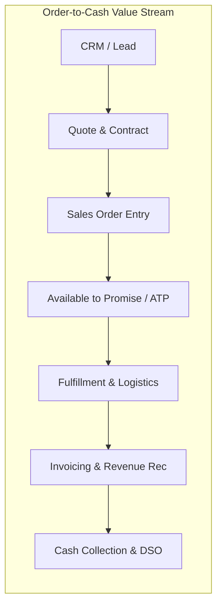

# The Next Move: Practical Guide to Business Process Translation
### Transitioning from a $92K Configurator to a $200K+ Enterprise Solution Architect

---

## 1. Executive Summary & The Core Paradigm Shift

In enterprise systems (SAP, Oracle, Microsoft Dynamics 365, Salesforce, NetSuite), the market pays based on **risk mitigation and business value creation**, not configuration keystrokes.

```
       COMMODITY TIER ($80K - $110K)                   HIGH-VALUE TIER ($180K - $250K+)
┌─────────────────────────────────────────┐     ┌─────────────────────────────────────────┐
│           "The Order Taker"             │     │      "The Process Translator"           │
│                                         │     │                                         │
│ • "Tell me what fields you need."       │     │ • "What operational KPI are we moving?" │
│ • Configures tables and custom scripts  │ ──► │ • Enforces standard process best practice│
│ • Creates 50 custom Z-tables/extensions │     │ • Eliminates technical debt & risk      │
│ • Module-siloed (MM only / SD only)     │     │ • End-to-End Enterprise Vision (O2C/P2P)│
└─────────────────────────────────────────┘     └─────────────────────────────────────────┘
```

The difference between a mid-tier technical consultant and an elite enterprise architect is **translation**: the ability to hear an ambiguous operational complaint, diagnose the systemic root cause, map it to an end-to-end data model, and successfully push back on unnecessary customization.

---

## 2. The 4-Pillar Translation Framework

### Pillar 1: Speaking Dual Dialects

| Business Executive Dialect | The Translation Layer | Technical Architecture Dialect |
| :--- | :--- | :--- |
| *"Our Days Sales Outstanding (DSO) jumped from 38 to 55 days."* | Dispute management + billing trigger latency | Batch invoicing job failures, missing customer credit-check validation, unapplied cash receipts table locking. |
| *"We are writing off $2M in inventory variance every quarter."* | Stock movement vs. Financial Ledger timing | Asynchronous goods receipt without GR/IR clearing line items, negative stock permissions, FIFO/Moving Avg valuation mismatches. |
| *"Orders take 4 days to release to the warehouse floor."* | Order validation bottleneck | Synchronous external credit API blocking asynchronous order orchestration queue; missing automated hold-release triggers. |

---

### Pillar 2: The 5-Whys Discovery Protocol
When stakeholders demand a custom field, script, or table, run this structured inquiry protocol:

1. **The Request:** *"We need a custom approval button and 3 custom status fields on the sales order header."*
2. **Why 1 (Functional Need):** Why can't the regional team use standard workflow approval?  
   *Answer:* "Because orders over $50k with margins under 12% need CFO sign-off."
3. **Why 2 (Policy Inquiry):** Why are high-value orders dropping below 12% margin?  
   *Answer:* "Sales reps apply manual promotional line discounts without seeing freight charges."
4. **Why 3 (Process Disconnect):** Why aren't freight charges calculated at order entry?  
   *Answer:* "The rate engine only runs at shipment creation, after picking."
5. **Why 4 (Root Cause):** The problem is **not** an approval button; the problem is **pricing sequence timing**.
6. **Architected Solution:** Implement automated pricing procedure condition technique (Standard) with pre-rated freight lookup rather than custom approval tables and technical debt.

---

### Pillar 3: Constructive Pushback & Customization Scorecard
Use this objective scorecard to challenge requested custom code ("Z-objects" or custom extensions):

```
Customization Request Viability Index (CRVI)
--------------------------------------------
[Score: 1 (Low) to 5 (High)]

1. Strategic Differentiator?   Does this process provide competitive market advantage?
2. Regulatory / Compliance?    Is this legally required by local tax/labor law?
3. Maintenance Cost Multiplier? Will this break during standard biannual system upgrades?
4. Process Standardization?    Can the business adjust its workflow to match standard best practice?

RULE: If Score < 12, REJECT customization. Present the standard Out-Of-The-Box (OOTB) workflow alternative.
```

---

### Pillar 4: Cross-Module / End-to-End (E2E) Process Mastery
High-earning consultants never stop at module boundaries. They specialize in enterprise-level value streams:



A change in **ATP checking rule (Logistics)** directly affects **Customer Retention (Sales)** and **Deferred Revenue Recognition (Finance)**.

---

## 3. Real-World "Done Work" Case Studies

### Case Study A: The Order-to-Cash (O2C) Revenue Leakage & Batch Bottleneck

#### 1. The Business Context
* **Client:** $800M Global Medical Device Manufacturer.
* **Problem:** Month-end financial close took 9 days. Order backlog exceeded $14M on the 30th of each month because orders were stuck in "Pending Review."

#### 2. What the $90K Consultant Did (The Order Taker)
* Added 8 new indexes to the sales order database table.
* Increased server RAM and split the batch billing jobs into 16 parallel threads.
* **Result:** System crashed under deadlock locks; problem remained unresolved.

#### 3. What the $200K Solution Architect Did (The Translator)
* **Root-Cause Analysis:** Mapped the end-to-end data flow from EDI arrival to GL posting.
* **Finding:** Business policy required credit checks to run synchronously against external Dun & Bradstreet APIs for every line item updated. When 10,000 orders arrived at month-end, the external API rate-limited the gateway, putting database records into permanent pending states.
* **Redesign:**
  1. Decoupled order capture from credit risk evaluation using an asynchronous event-driven pattern.
  2. Implemented credit exposure limits calculated once nightly, enabling standard deterministic local credit checks during order creation.
  3. Configured standard automatic exception clearing for trusted tier-1 hospital accounts.
* **Measurable ROI:**
  * Month-end close reduced from **9 days to 2.5 days**.
  * Backlog dropped by **82% ($11.5M unlocked)**.
  * Zero custom database tables built; 100% standard configuration.

---

### Case Study B: The Procure-to-Pay (P2P) Inventory Valuation Crisis

#### 1. The Business Context
* **Client:** Multi-facility industrial fabrication enterprise.
* **Problem:** $3.4M unexplained inventory variance at annual physical inventory count. Finance and Plant Managers were in conflict over unaccounted stock.

#### 2. The Architectural Diagnosis
* Purchasing was issuing Purchase Orders with "Estimated Cost" overrides.
* Goods Receipts (GR) posted at standard cost, while Accounts Payable (AP) processed invoices at actual vendor invoice cost weeks later without a standard 3-way matching tolerance enforcement.
* Plant workers were receiving items without batch traceability, allowing negative stock balances to post temporary inventory valuations.

#### 3. The Work Done (Deliverables)
1. **Process Realignment:** Configured strict **3-way matching (PO - GR - Invoice Receipt)** with a hard 2% tolerance limit.
2. **System Guardrails:** Deactivated negative inventory allowances across all plant storage locations.
3. **Automated GR/IR Clearing Account Revaluation:** Built scheduled clearing variance triggers and automated debit memos to suppliers for unauthorized overbilling.
* **Measurable ROI:** Inventory reconciliation variance fell from **$3.4M to under $85K (97.5% improvement)** within two quarters.

---

## 4. Production Artifacts & Templates (Ready to Deploy)

### Template 1: Business-to-Technical Translation Matrix (BTTM)
*Use this in your Functional Design Documents (FDD) instead of raw technical specs:*

| Business Objective & KPI | Operational Constraint | Standard ERP Capability | Proposed Solution Architecture | Impact on Upgrades & Tech Debt |
| :--- | :--- | :--- | :--- | :--- |
| Reduce order processing cycle time by 40% | Complex tiered volume discounts based on annual spend | Standard Pricing Condition Technique (e.g., SAP `PR00`/Scale Pricing or D365 Price Agreements) | Configure scale discount matrices linked to customer hierarchy records | **Zero custom code**. Retains 100% native vendor supportability. |
| Prevent stockouts of high-velocity spare parts | Lead time variability from overseas shipping routes | Dynamic Safety Stock & MRP Reorder Point Parameters | Configure safety stock calculation based on mean absolute deviation (MAD) | Leverages native planning run without external batch customization. |

---

### Template 2: Executive Decision Memo (Pushback on Customization)

```markdown
# EXECUTIVE DECISION MEMORANDUM

**TO:** Steering Committee / CIO / CFO  
**FROM:** Enterprise Lead Solution Architect  
**DATE:** [Date]  
**SUBJECT:** Evaluation of Custom Extension Request [CR-104: Custom Rebate Engine]

### 1. Executive Summary
The commercial sales team has requested a bespoke custom application to manage customer quarterly rebates. 
**Architect Recommendation:** REJECT bespoke custom build. IMPLEMENT native ERP Settlement Management.

### 2. Total Cost of Ownership (TCO) Comparison
| Dimension | Option A: Custom Development | Option B: Standard Native Settlement |
| :--- | :--- | :--- |
| **Initial Build Cost** | $145,000 (3 developers / 10 weeks) | $22,000 (Config & workshop / 2 weeks) |
| **5-Year Maintenance** | $180,000 (Regression testing per upgrade) | $0 (Included in vendor release roadmap) |
| **Audit Risk** | High (Custom code requires annual external audit) | Low (Certified standard GAAP/IFRS compliant) |

### 3. Operational Trade-Off
Adopting standard settlement requires sales managers to enter contract rebates by customer parent grouping 
rather than free-form text. This introduces minor operational discipline while saving the organization $303,000 over 5 years.
```

---

## 5. How to Reposition Your Resume & Portfolio for $200K+ Roles

### Bullet Point Transformation: Before vs. After

| Ordinary Configurator ($90K) | Enterprise Solution Architect ($200K+) |
| :--- | :--- |
| *"Configured SAP MM/SD module pricing procedures and customized standard tables for purchase orders."* | *"Architected global Order-to-Cash pricing architecture across 14 operating units, cutting order processing latency by 35% and preventing $1.2M in annual unbilled freight leakage."* |
| *"Created custom reports and batch jobs for month-end financial reporting."* | *"Spearheaded financial close acceleration program, optimizing GL posting integration and reducing month-end close cycle from 9 days to 3 days."* |
| *"Gathered user requirements and wrote 45 technical specification documents for developers."* | *"Led cross-functional business-to-technical discovery workshops across Supply Chain and Finance, eliminating 60+ redundant customization requests and preserving core ERP upgradeability."* |

---

## 6. Your 90-Day Execution Roadmap

```
┌────────────────────────────────────────────────────────────────────────┐
│ Days 1 - 30: The Language Pivot                                        │
│ • Stop discussing transaction codes / database tables with executives. │
│ • Study financial statements (10-K filings, P&L, balance sheets, DSO). │
│ • Shadow actual plant, warehouse, and AP clerks for 1 full day each.   │
├────────────────────────────────────────────────────────────────────────┤
│ Days 31 - 60: The Artifact Audit                                       │
│ • Audit your current project's backlog of custom requests.             │
│ • Draft 1 Business-to-Technical Translation Matrix for a live feature. │
│ • Successfully replace at least one custom code request with standard. │
├────────────────────────────────────────────────────────────────────────┤
│ Days 61 - 90: The Market Repositioning                                 │
│ • Rewrite your LinkedIn & resume focusing on business outcomes and ROI.│
│ • Assemble 3 architecture case studies highlighting E2E problem solving.│
│ • Target Solution Architect, Advisory Consultant, or Client-Side Lead. │
└────────────────────────────────────────────────────────────────────────┘
```
